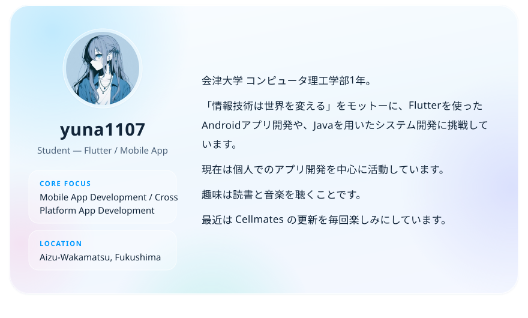
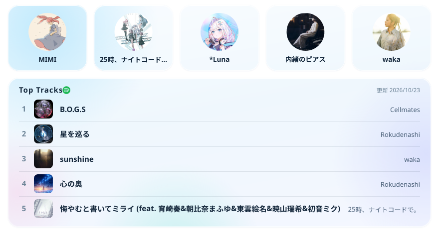
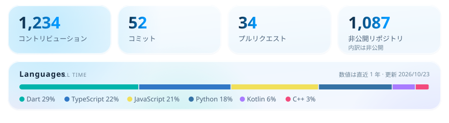

<a href="https://yuna1107.com" title="https://yuna1107.com"><picture><source media="(prefers-color-scheme: dark)" srcset="./assets/hero-dark.svg"></picture></a>

<a href="https://yuna1107.com" title="https://yuna1107.com"><picture><source media="(prefers-color-scheme: dark)" srcset="./assets/link-website-dark.svg"></picture></a><a href="mailto:information@yuna1107.com" title="information@yuna1107.com"><picture><source media="(prefers-color-scheme: dark)" srcset="./assets/link-mail-dark.svg"></picture></a><a href="https://github.com/yuna1107-k" title="https://github.com/yuna1107-k"><picture><source media="(prefers-color-scheme: dark)" srcset="./assets/link-github-dark.svg"></picture></a><a href="https://x.com/yuna1107m" title="https://x.com/yuna1107m"><picture><source media="(prefers-color-scheme: dark)" srcset="./assets/link-x-dark.svg"></picture></a><a href="https://www.instagram.com/yuna1107k/" title="https://www.instagram.com/yuna1107k/"><picture><source media="(prefers-color-scheme: dark)" srcset="./assets/link-instagram-dark.svg"></picture></a><a href="https://mixi.social/@yuna1107" title="https://mixi.social/@yuna1107"><picture><source media="(prefers-color-scheme: dark)" srcset="./assets/link-mixi2-dark.svg"></picture></a><a href="https://blog.yuna1107.com" title="https://blog.yuna1107.com"><picture><source media="(prefers-color-scheme: dark)" srcset="./assets/link-blog-dark.svg"></picture></a><a href="https://note.com/yuna1107" title="https://note.com/yuna1107"><picture><source media="(prefers-color-scheme: dark)" srcset="./assets/link-note-dark.svg"></picture></a>

<picture><source media="(prefers-color-scheme: dark)" srcset="./assets/title-about-me-dark.svg"></picture>

<picture><source media="(prefers-color-scheme: dark)" srcset="./assets/about-dark.svg"></picture>

<picture><source media="(prefers-color-scheme: dark)" srcset="./assets/title-music-dark.svg"></picture>

<a href="https://yuna1107.com/#activity" title="https://yuna1107.com/#activity"><picture><source media="(prefers-color-scheme: dark)" srcset="./assets/music-dark.svg"></picture></a>

<picture><source media="(prefers-color-scheme: dark)" srcset="./assets/title-github-dark.svg"></picture>

<picture><source media="(prefers-color-scheme: dark)" srcset="./assets/github-dark.svg"></picture>

&copy; 2026 yuna1107 · <a href="https://yuna1107.com">yuna1107.com</a>

